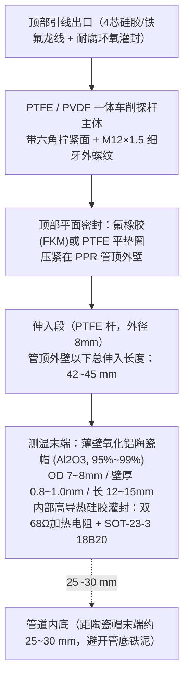
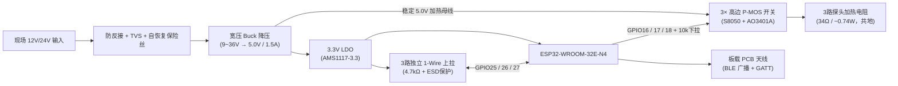

# 污水处理厂三通道脉冲热式管道有液检测传感器 — 系统设计规格书 (v1.0)

> 本规格书基于现场工况深度对齐结果编制，面向 **自主硬件电路 + 机械结构 + ESP32 固件** 全栈研发。

---

## 1. 应用场景与设计边界

| 项目 | 规格 / 约束 |
| :--- | :--- |
| **应用环境** | 污水处理厂，**室外小铁皮屋（山东济南）**；热环境等同室外（冬季低至 **-10℃**，夏季室外 35℃、铁皮屋内可达 **50~60℃**）；需注意铁皮屋对 BLE 2.4GHz 信号的屏蔽衰减 |
| **管道参数** | 3 根平行水平 PPR 管，外径 **75 mm**，壁厚 **5 mm**（内径 **65 mm**）；水平间距约 **200 mm**；离地间隙仅 **30~50 mm** |
| **被测介质** | ① 碳源（粘稠、易结晶/长菌膜） ② 次氯酸钠（强氧化、强碱、易析气、略温） ③ 聚合氯化铁（强酸、强氧化 $Fe^{3+}+Cl^-$、极易结铁垢/沉泥）；均无易燃易爆风险 |
| **流态特征** | 罐车重力自流（10~30 吨 / ~2 小时，流速约 0.4~1.3 m/s），卸料时液位至少半管以上；卸料结束入口敞开、管内排空无静置存液 |
| **检测目标** | 3 路独立二值状态：**有液 / 空管**（含故障态），响应时间 **≤ 60 s** |
| **系统架构** | **1 拖 3 单主控盒**（1 块 ESP32 + 3 支独立热式探头），12V/24V 供电，BLE 蓝牙无线输出 |

---

## 2. 传感原理：脉冲热式（自加热温差法）

探头末端内置**加热电阻**与 **贴片 SOT-23-3 数字温度传感器（18B20，如 GX18B20 / M1820）**，周期性对探头施加短时定功率加热脉冲（如 **0.74 W × 6 s**），只测量加热前后的**温升差值 $\Delta T = T_1 - T_0$**：

- **空管（空气）**：静止空气对流散热极差，6 秒内产生明显温升（典型 $\Delta T_{\text{empty}} \approx 8\sim15^\circ\text{C}$）。
- **有液（流动液体）**：流动水溶液对流换热系数比空气高几十倍，热量被迅速带走，温升极小（典型 $\Delta T_{\text{wet}} \approx 1\sim3^\circ\text{C}$）。
- **核心优势**：
  1. **不受介质/环境温度影响**：只看相对温升 $\Delta T$，即使次氯酸钠温度略高于室温或济南四季温差 -10℃~+60℃，也不误判。
  2. **全温区数字精度**：贴片 18B20 在 -55℃~+125℃ 全温区提供 0.0625℃ 数字分辨力与 CRC-8 校验，彻底规避模拟 ADC 低温饱和与高温噪声。
  3. **极强抗挂壁能力**：即便探头表面挂有一层薄湿膜或铁垢，只要无流动液体冲刷散热，温升依然明显高于有液状态；且低功率短脉冲不会将药剂烤干结痂。

---

## 3. 机械结构与耐腐蚀设计

### 3.1 探头结构（零金属裸露）

> ⚠️ **材料红线**：聚合氯化铁（$Fe^{3+} + Cl^-$）与次氯酸钠会迅速点蚀穿孔 304/316L 不锈钢，接液部分**严禁暴露任何普通金属**。

### 3.2 关键尺寸与安装工艺
- **开孔攻丝**：在 PPR 管正顶部钻孔并攻 **M12×1.5 细牙内螺纹**（5 mm 壁厚可咬合约 3.3 圈螺纹，优于粗牙）。
- **防漏与防滑丝要点**：
  - 探杆螺纹处缠绕适量 **PTFE 生料带**，顶部六角法兰下压 **氟橡胶（FKM）平垫圈**。
  - 加工时控制法兰台阶面，拧紧至垫圈微压缩即可，**切忌用扳手暴力过拧**导致 5 mm PPR 管壁滑丝。
- **插入深度**：PPR 管顶外壁到管内底共 **70 mm**；探头总伸入长度定为 **42~45 mm**，末端位于管道中心附近（距管内底 **25~30 mm**），完全避开管底铁泥沉积，同时满足半管以上自流浸没要求。
- **陶瓷帽与 PTFE 杆粘接**：采用阶梯过盈配合 + 耐酸碱环氧/氟硅胶密封，确保接缝不渗液。

### 3.3 主控盒封装
- **外壳**：极简无灯暗盒（IP65 级 ABS/PC 塑料防水盒），外壳**不开任何 LED 孔洞**以最大化防水防腐蚀。
- **进出线**：底部配 4 个 **PG7 防水葛兰头**（3 路探头 4 芯线 + 1 路 12V/24V 电源线），内部接插拔式接线端子，方便日后单路更换探头。

---

## 4. 硬件电路架构（12V/24V 输入，一拖三）

### 4.1 系统框图

### 4.2 核心电路设计要点
1. **双级稳压保证加热功率恒定**：
   - 输入端用宽压 Buck（**XL1509-5.0E1**，40V 耐压）统一降压为 **稳定 5.0V**，无论现场接入 12V 还是 24V，单路加热功率恒定在 ~0.74 W（电流 ~147 mA）。
   - 再经 LDO（**AMS1117-3.3**）降为 **3.3V** 给 ESP32-WROOM-32E 与 18B20 供电。
2. **高边 P-MOS 加热 + 4 芯共地线缆**：
   - 加热采用高边开关（`S8050` + `AO3401A`），探头内加热电阻与 18B20 共用 `GND`，因此每支探头只需 **4 芯线**（`HEAT_5V_SW`、`VDD_3V3`、`DQ`、`GND`）；数字 1-Wire 抗地弹能力极强，不受 150 mA 加热电流影响。
   - GPIO 控制脚加 **10 kΩ 下拉电阻**，保证 ESP32 上电/复位/宕机时加热器默认强制关闭。
3. **3 路独立 1-Wire 总线**：
   - 3 支 18B20 分别接 `GPIO25 / GPIO26 / GPIO27`（不共用总线），更换单支探头免 ROM 配对、单路短路不牵连其他通道。
4. **板内调试接口与状态灯**：内置 Type-C + CH340C 烧录调试口及板内调试 LED（外壳不开灯孔）。

---

## 5. 固件时序、算法与 BLE 通信协议

### 5.1 分时轮巡时序（30 秒完整周期）

每 30 秒完成 3 根管道的全部检测，远快于 60 秒响应指标，且每支探头加热 6 秒后有 **24 秒充分散热恢复期**：

| 时间段 | 通道 1（碳源） | 通道 2（次氯酸钠） | 通道 3（聚合氯化铁） |
| :--- | :--- | :--- | :--- |
| **0 ~ 1 s** | 采样基准温度 $T_{0,1}$（64次过采样均值） | 散热冷却 | 散热冷却 |
| **1 ~ 7 s** | 开启加热（6 s），末期采样 $T_{1,1}$，计算 $\Delta T_1$ | 散热冷却 | 散热冷却 |
| **7 ~ 10 s** | 关闭加热，更新状态与 BLE 广播 | 散热冷却 | 散热冷却 |
| **10 ~ 20 s** | 散热冷却 | 同上流程，更新 $\Delta T_2$ | 散热冷却 |
| **20 ~ 30 s** | 散热冷却 | 散热冷却 | 同上流程，更新 $\Delta T_3$ |

### 5.2 一键标定、判定逻辑与故障自检
- **空管一键标定**：现场装好探头、确认三管排空后，通过 BLE GATT 写入标定指令，系统自动连续测 3 轮空管温升取均值，将各通道的 $\Delta T_{\text{empty}, i}$ 存入 **ESP32 NVS Flash**（掉电不丢失），自动消除手工灌封差异。
- **带迟滞比例判据（防抖）**：
  - 判定为 **有液 (`LIQUID`)**：$\Delta T_i < 0.45 \times \Delta T_{\text{empty}, i}$
  - 判定为 **空管 (`EMPTY`)**：$\Delta T_i > 0.60 \times \Delta T_{\text{empty}, i}$
  - 中间 45%~60% 为迟滞区，保持上一状态不变；可配置连续 2 周期确认（最大延迟 60 s）彻底杜绝偶发误报。
- **探头与系统自检**：
  - **18B20 断线/短路/CRC 校验自检**：读取失败或返回 `DEVICE_DISCONNECTED_C` 时，立即标记对应通道为 `FAULT_SENSOR` 并禁止该路加热。
  - **软件看门狗（TWDT）**：防止程序跑飞导致加热常开。

### 5.3 BLE 双模式通信设计
1. **BLE 广播（Manufacturer Specific Data，每 1~2 s 广播一次）**：
   - 接收端网关/主控器无需建立连接即可被动扫描解析，极度稳定。
   - 建议自定义载荷（12 字节）：
     - `Byte 0`: 协议版本 / 帧计数（心跳防卡死）
     - `Byte 1`: 3 路状态位掩码（每路 2 bit：`00=空管`, `01=有液`, `10=未标定`, `11=探头故障`）
     - `Byte 2~3`: Ch1 最新温升 $\Delta T_1$（单位 0.1℃，有符号 int16）
     - `Byte 4~5`: Ch2 最新温升 $\Delta T_2$
     - `Byte 6~7`: Ch3 最新温升 $\Delta T_3$
     - `Byte 8~9`: 环境参考温度 $T_0$ 均值（单位 0.1℃）
     - `Byte 10~11`: CRC16 校验
2. **BLE GATT 服务（调试与标定）**：
   - `Char_LiveData (Read/Notify)`：读取 3 路实时 $T_0, T_1, \Delta T$、ADC 原始值、状态。
   - `Char_Config (Read/Write)`：写入一键空管标定指令、读写 3 路 $\Delta T_{\text{empty}}$ 与比例阈值（如 45%/60%）。

---

## 6. 核心元器件预估 BOM（单套一拖三）

| 类别 | 器件/材料 | 规格型号建议 | 数量 | 备注 |
| :--- | :--- | :--- | :---: | :--- |
| **主控** | ESP32 模组 | **ESP32-WROOM-32E-N4** + CH340C 调试串口 | 1 | 板载 PCB 天线（已实测穿铁皮屋良好） |
| **电源** | 宽压 Buck + LDO | XL1509-5.0E1 (5V) + AMS1117-3.3 | 1 套 | 兼容 12V/24V，稳压 5V 加热 |
| **驱动** | 高边 P-MOS 开关 | AO3401A (P-MOS) + S8050 (NPN) | 3 套 | 高边开关，探头共地仅需 4 芯线 |
| **探头核心** | 氧化铝陶瓷帽 | 95% $\text{Al}_2\text{O}_3$，OD 8mm×ID 6mm×L20mm | 3 | 高导热、耐强酸强氧化 |
| **探头外壳** | PTFE 车削探杆 | M12×1.5 细牙 + 低温氟橡胶(GLT-FKM)垫圈 | 3 | 伸入管内 42~45 mm |
| **测温/加热** | 贴片 18B20 + 加热电阻 | **SOT-23-3 18B20 (GX18B20/M1820)** + 双 68Ω 1206 | 3 套 | 高导热硅胶灌封入陶瓷帽 |
| **外壳与辅材** | IP65 防水盒 + PG7 | ABS 暗盒 + 4×PG7 葛兰头 + 4芯硅胶线 | 1 套 | 外壳不开灯孔 |
