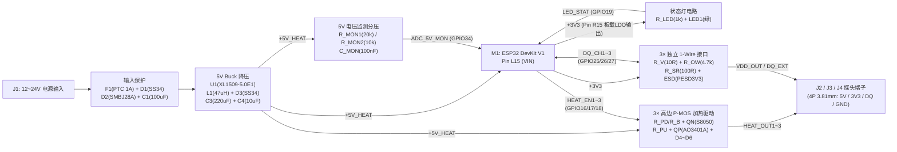

# 主控板原理图设计文档（ESP32 DevKit V1 30P 载板版）

> **文档基准**：本文档严格依据当前最新主控板 PCB 工程文件 [main_board_pcb.kicad_pcb](../hardware/pcb/main_board_pcb/main_board_pcb.kicad_pcb)（生成器 [generate_main_pcb.py](../hardware/pcb/main_board_pcb/generate_main_pcb.py)，`v4`）及固件工程 [src/config.h](../src/config.h) 编制，可直接用于立创 EDA / KiCad 原理图绘制、BOM 采购、焊接装配与上电测试。

---

## 1. 概述与架构说明

### 1.1 基本参数
| 项目 | 规格说明 |
| :--- | :--- |
| **板卡名称** | WST 3-CH 脉冲热式液位传感器主控载板（Carrier Board） |
| **PCB 尺寸与层数** | `88.0 × 78.0 mm`，2 层 FR4，板厚 `1.6 mm`，4× M3 安装孔（`H1~H4`，孔径 Ø3.2 mm） |
| **核心主控** | 插接式 **ESP32 DevKit V1（30-Pin DOIT 标准，双排 1×15P 2.54 mm 母座，排距 25.40 mm）** |
| **电源输入** | 工业宽压 **DC 12V ~ 24V**（内部降压至恒定 `+5.0V`） |
| **输出通道** | 3 路独立热式探头接口（`J2` 碳源、`J3` 次氯酸钠、`J4` 聚合氯化铁），4 芯共地线缆 |
| **元器件统计** | 49 颗电气元器件 + 4 个安装孔（共 53 个封装），31 条有效电气网络 |

### 1.2 与早期草稿（`hardware_design.md` v2.0）的关键差异
为便于团队对齐，当前实际 PCB 方案相较早期裸模组方案做了以下工程优化：
1. **主控形态升级为插接载板**：取消底板上的 `ESP32-WROOM-32E` 裸模组、`CH340C`、Type-C 接口、`AMS1117-3.3` 及 `RST/BOOT` 按键，改为插接 **30-Pin ESP32 DevKit V1**，直接复用开发板自带的 USB 下载口、3.3V LDO 与天线，大幅精简 BOM 并降低贴片/维修难度。
2. **加热续流二极管封装优化**：3 路加热续流二极管 `D4~D6` 由 `SS14 (SMA)` 精简为 **`1N5819WS (SOD-123)`**。
3. **探头加热功率适配**：配套探头微型板（[generate_probe_pcb.py](../hardware/pcb/probe_mini_pcb/generate_probe_pcb.py)）采用 `2×33 Ω` 并联 = **`16.5 Ω`**，在恒定 `5.0V` 加热母线下单路加热功率约为 **1.52 W（~303 mA）**，适配壁厚 2 mm 氧化铝陶瓷盲管。

---

## 2. 系统总体原理框图



---

## 3. 主控模块（`M1`）完整引脚分配表

`M1` 为 **ESP32 DevKit V1（30-Pin，25.4 mm 排距）**，安装方向：**PCB 天线朝上（板顶净空区），USB 接口朝下**。所有已用信号均已避开 Strapping 启动脚与内部 Flash 引脚。

### 3.1 左侧排针（`L1` ~ `L15`，自上而下）
| 排针脚位 | DevKit 丝印 | 原理图网络标号 | 固件定义 | 功能说明 |
| :---: | :---: | :--- | :--- | :--- |
| `L1` | `EN` | *(NC)* | — | 开发板自带上拉与复位按键 |
| `L2` | `VP (GPIO36)` | *(NC)* | — | 悬空预留 |
| `L3` | `VN (GPIO39)` | *(NC)* | — | 悬空预留 |
| **`L4`** | **`D34 (GPIO34)`** | **`ADC_5V_MON`** | `PIN_5V_MON = 34` | `ADC1_CH6`，监测 `+5V_HEAT` 母线电压（1/3 分压） |
| `L5` | `D35 (GPIO35)` | *(NC)* | — | 悬空预留 |
| `L6` | `D32 (GPIO32)` | *(NC)* | — | 悬空预留 |
| `L7` | `D33 (GPIO33)` | *(NC)* | — | 悬空预留 |
| **`L8`** | **`D25 (GPIO25)`** | **`DQ_CH1`** | `THERMAL_DQ_1_PIN = 25` | 通道 1（碳源）1-Wire 测温数据线 |
| **`L9`** | **`D26 (GPIO26)`** | **`DQ_CH2`** | `THERMAL_DQ_2_PIN = 26` | 通道 2（次氯酸钠）1-Wire 测温数据线 |
| **`L10`** | **`D27 (GPIO27)`** | **`DQ_CH3`** | `THERMAL_DQ_3_PIN = 27` | 通道 3（聚合氯化铁）1-Wire 测温数据线 |
| `L11` | `D14 (GPIO14)` | *(NC)* | — | 悬空预留 |
| `L12` | `D12 (GPIO12)` | *(NC)* | — | Strapping 引脚，保持悬空 |
| `L13` | `D13 (GPIO13)` | *(NC)* | — | 悬空预留 |
| **`L14`** | **`GND`** | **`GND`** | — | 系统参考地 |
| **`L15`** | **`VIN (5V)`** | **`+5V_HEAT`** | — | 5.0V 电源输入（由载板 `U1` 供电） |

### 3.2 右侧排针（`R1` ~ `R15`，自上而下）
| 排针脚位 | DevKit 丝印 | 原理图网络标号 | 固件定义 | 功能说明 |
| :---: | :---: | :--- | :--- | :--- |
| `R1` | `D23 (GPIO23)` | *(NC)* | — | 悬空预留 |
| `R2` | `D22 (GPIO22)` | *(NC)* | — | 悬空预留 |
| `R3` | `TX0 (GPIO1)` | *(NC)* | — | 开发板自带 USB 串口 |
| `R4` | `RX0 (GPIO3)` | *(NC)* | — | 开发板自带 USB 串口 |
| `R5` | `D21 (GPIO21)` | *(NC)* | — | 悬空预留 |
| **`R6`** | **`D19 (GPIO19)`** | **`LED_STAT`** | `PIN_LED_STAT = 19` | 板内调试状态灯驱动（低电平点亮） |
| **`R7`** | **`D18 (GPIO18)`** | **`HEAT_EN3`** | `THERMAL_HEAT_3_PIN = 18` | 通道 3（聚合氯化铁）加热使能（高电平有效） |
| `R8` | `D5 (GPIO5)` | *(NC)* | — | 悬空预留 |
| **`R9`** | **`D17 (TX2/GPIO17)`** | **`HEAT_EN2`** | `THERMAL_HEAT_2_PIN = 17` | 通道 2（次氯酸钠）加热使能（高电平有效） |
| **`R10`** | **`D16 (RX2/GPIO16)`** | **`HEAT_EN1`** | `THERMAL_HEAT_1_PIN = 16` | 通道 1（碳源）加热使能（高电平有效） |
| `R11` | `D4 (GPIO4)` | *(NC)* | — | 悬空预留 |
| `R12` | `D2 (GPIO2)` | *(NC)* | `PIN_LED_ONBOARD = 2` | Strapping 引脚（载板侧悬空；固件复用开发板板载蓝色 LED 指示 WiFi/MQTT） |
| `R13` | `D15 (GPIO15)` | *(NC)* | — | Strapping 引脚，保持悬空 |
| **`R14`** | **`GND`** | **`GND`** | — | 系统参考地 |
| **`R15`** | **`3V3`** | **`+3V3`** | — | 3.3V 稳压输出（由开发板板载 LDO 提供给载板） |

---

## 4. 分模块详细原理图与电路解析

### 4.1 工业宽压电源模块（12V~24V → 恒定 +5.0V）

```text
J1 (5.08mm 2P)
Pin1 (VIN_RAW) ──► [F1: PTC 1A/36V] ──(VIN_FUSE)──► [D1: SS34 (A→K)] ──┬──(VIN_PROT)──► U1 Pin1 (VIN)
                                                                       │                U1: XL1509-5.0E1 (SOIC-8)
                                                          [D2: SMBJ28A (K)]             Pin2 (OUTPUT) ──(XL_SW)──┬──► [L1: 47uH/3A] ──┬──► +5V_HEAT
                                                          [C1: 100uF/35V (+)]           Pin3 (FB) ◄──────────────┼────────────────────┤
                                                                       │                Pin4 (ON/OFF) ──► GND    │                    ├──► [C3: 220uF/10V (+)]
                                                                       │                Pin5~8 (GND) ───► GND    │                    ├──► [C4: 10uF X7R]
Pin2 (GND) ────────────────────────────────────────────────────────────┴─────────────────────────────────────────┴─ [D3: SS34 (A←GND, K→XL_SW)] ──┴──► GND
```

- **前级保护回路**：
  - `F1 (1A / 36V PTC)`：后端短路或异常过流时自动高阻断开，故障排除后自恢复。
  - `D1 (SS34, 40V/3A)`：串联肖特基二极管实现电源防反接保护，正向压降低（~0.45V）。
  - `D2 (SMBJ28A)`：单向 28V TVS 管（阴极接 `VIN_PROT`，阳极接 `GND`），抑制工业现场 24V 电源线上的感性开关浪涌与雷击感应尖峰。
  - `C1 (100 µF / 35V)`：输入储能与低频纹波滤波电容（务必选用 **-40~105℃ 工业宽温低 ESR 电解电容**）。
- **Buck 稳压核心（`U1: XL1509-5.0E1`）**：
  - 耐压 40V，开关频率 150 kHz，固定 5.0V 输出，最大持续电流 2A。
  - Pin 3 (`FB`) 直接接 `+5V_HEAT` 实现固定 5.0V 闭环稳压；Pin 4 (`ON/OFF`) 接地使其常开；Pin 5~8 全部接地兼作散热通道。
  - `D3 (SS34)` 为 Buck 续流肖特基二极管（阳极接 `GND`，阴极接 `XL_SW`），与 `L1 (47 µH / 3A)`、`C3 (220 µF / 10V)`、`C4 (10 µF X7R)` 组成低纹波 5.0V 功率输出级。
- **功率预算核算**：
  - 固件采用三通道分时轮巡加热（任一时刻最多 1 路加热）：单路探头负载 `16.5 Ω`，加热电流 $I_{\text{heat}} = 5.0 / 16.5 \approx 303\text{ mA}$（1.52 W）。
  - 叠加 ESP32 BLE 发射峰值电流（~200~250 mA），系统总 5V 峰值电流约 **0.55 A**，远低于 `XL1509` 的 2A 额定输出与 `F1` 的 1A 保持电流，裕量充足。

---

### 4.2 5V 母线监测与板内调试状态灯

```text
+5V_HEAT ──► [R_MON1: 20kΩ 1%] ──┬──(ADC_5V_MON)──► M1 Pin L4 (GPIO34 / ADC1_CH6)
                                 ├──► [R_MON2: 10kΩ 1%] ──► GND
                                 └──► [C_MON: 100nF] ─────► GND

+3V3 ──────► [R_LED: 1kΩ] ───────►(LED_A)──► [LED1: 绿色 0603 (A→K)] ──(LED_STAT)──► M1 Pin R6 (GPIO19)
```

- **5V 母线自检分压**：
  - 分压比 $\frac{R_{\text{MON2}}}{R_{\text{MON1}} + R_{\text{MON2}}} = \frac{10\text{k}}{20\text{k} + 10\text{k}} = \frac{1}{3}$。
  - 正常 5.0V 时 `ADC_5V_MON` 电压为 **1.667 V**，正好位于 ESP32 ADC 最佳线性区；`C_MON (100 nF)` 滤除开关电源高频毛刺；固件中 `read_5v_bus()` 采样 16 次求均值后乘以 `3.0f` 还原母线电压。
- **状态指示灯**：
  - `GPIO19` 输出低电平时 `LED1` 点亮，工作电流约 $\frac{3.3\text{V} - 2.0\text{V}}{1\text{k}\Omega} \approx 1.3\text{ mA}$，用于开盒调试与标定状态指示。

---

### 4.3 三通道高边 P-MOS 加热驱动电路（CH1~CH3 完全相同）

> 以通道 `n`（$n \in \{1, 2, 3\}$，对应 `HEAT_EN1/2/3 = GPIO16/17/18`，续流二极管 `D4/D5/D6`）为例：

```text
                                                +5V_HEAT
                                                   │
                                           ┌───────┴───────┐
                                      [R_PU{n}: 10kΩ]    Pin2 (Source)
                                           │         [QP{n}: AO3401A (P-MOS)]
                                           ├──(PMOS_G{n})─► Pin1 (Gate)
                                           │             Pin3 (Drain)
                                      Pin3 (Collector)     ├──(HEAT_OUT{n})──► J{n+1} Pin1 ──► [探头 16.5Ω 加热电阻] ──► GND
M1 GPIO16/17/18 ──┬──► [R_B{n}: 2.2kΩ] ─(NPN_B{n})─► Pin1 (Base) [QN{n}: S8050]  │
  (HEAT_EN{n})    │                                 Pin2 (Emitter)         [D{n+3}: 1N5819WS (K↑, A↓)]
             [R_PD{n}: 10kΩ]                               │                     │
                  │                                        ▼                     ▼
                 GND                                      GND                   GND
```

- **为什么必须采用高边 P-MOS？**
  - 探头内部 DS18B20 与加热电阻共用 `GND` 回流，采用 5V 高边开关后每支探头只需 **4 芯线缆**（`5V_HEAT / 3V3 / DQ / GND`），大幅简化现场布线与防水葛兰头密封。
- **电平转换与失效安全机制**：
  - **关断 / 上电复位 / 高阻态**：`R_PD{n} (10 kΩ)` 将 `HEAT_EN{n}` 强制下拉至 `GND`，NPN 三极管 `QN{n} (S8050)` 截止，`R_PU{n} (10 kΩ)` 将 `QP{n} (AO3401A)` 栅极上拉至 `+5V_HEAT`（$V_{GS} = 0\text{V}$），P-MOS 彻底关断，**确保系统上电或固件异常时绝不误加热干烧**。
  - **开启加热（`HEAT_EN{n} = HIGH, 3.3V`）**：基极电流 $I_B \approx \frac{3.3 - 0.7}{2.2\text{k}} \approx 1.18\text{ mA}$，`S8050` 深度饱和导通，将 `PMOS_G{n}` 拉低至 ~0.15V（$V_{GS} \approx -4.85\text{V}$），`AO3401A` 充分导通（$R_{DS(on)} < 50\text{ m}\Omega$，303 mA 下压降仅 ~15 mV，几乎无发热）。
- **线缆感性续流保护**：
  - `D4~D6 (1N5819WS, SOD-123)` 反向并联在 `HEAT_OUT{n}` 与 `GND` 之间（阴极接 `HEAT_OUT{n}`，阳极接 `GND`），吸收 1.5 m 长线缆在加热关断瞬间的负向感性反电动势，保护 `AO3401A`。

---

### 4.4 三通道独立 1-Wire 测温与 ESD 保护接口（CH1~CH3 完全相同）

> 以通道 `n`（$n \in \{1, 2, 3\}$，对应 `DQ_CH1/2/3 = GPIO25/26/27`，端子 `J2/J3/J4`）为例：

```text
+3V3 ──┬──► [R_V{n}: 10Ω] ───────────────────(VDD_OUT{n})──► J{n+1} Pin2 ──► 探头 18B20 VDD (+100nF)
       │
   [R_OW{n}: 4.7kΩ]
       │
       ├──► [R_SR{n}: 100Ω] ──(DQ_CH{n})──► M1 GPIO25/26/27
       │
       ├──► [ESD{n}: PESD3V3 (K↑, A↓)] ──► GND
       │
       └──(DQ_EXT{n})─────────────────────► J{n+1} Pin3 ──► 探头 18B20 DQ

GND ──────────────────────────────────────► J{n+1} Pin4 ──► 探头 GND (18B20 与加热电阻共地)
```

- **设计要点**：
  1. **三路物理独立总线**：互不串扰、免 64 位 ROM 地址绑定，现场任意单路探头损坏可直接拔插更换；即使某路探头进水短路也不会拖垮其余两路。
  2. **三重端口防护**：`R_V{n} (10 Ω)` 限制探头电源端误短路冲击电流；`R_SR{n} (100 Ω)` 抑制 1.5 m 线缆反射振铃并限制灌入 ESP32 IO 的故障电流；`ESD{n} (PESD3V3)` 泄放现场静电与耦合浪涌。
  3. **探头端子统一线序（`J2 / J3 / J4`，KF2EDGK 3.81 mm 4P）**：
     - `Pin 1`：`HEAT_OUT{n}`（5V 高边脉冲加热正极）
     - `Pin 2`：`VDD_OUT{n}`（3.3V 测温电源）
     - `Pin 3`：`DQ_EXT{n}`（1-Wire 数据线）
     - `Pin 4`：`GND`（公共地）

---

## 5. 完整电气网络表（Netlist，共 31 条有效网络）

以下网络表与 [main_board_pcb.kicad_pcb](../hardware/pcb/main_board_pcb/main_board_pcb.kicad_pcb) 逐引脚 100% 对应，可在原理图绘制完成后用于核对连线完整性：

| 序号 | 网络名称 | 连接引脚列表（位号.脚号） |
| :---: | :--- | :--- |
| 1 | `VIN_RAW` | `J1.1`, `F1.1` |
| 2 | `VIN_FUSE` | `F1.2`, `D1.1(A)` |
| 3 | `VIN_PROT` | `D1.2(K)`, `D2.1(K)`, `C1.1(+)`, `U1.1(VIN)` |
| 4 | `XL_SW` | `U1.2(SW)`, `D3.2(K)`, `L1.1` |
| 5 | `+5V_HEAT` | `L1.2`, `U1.3(FB)`, `C3.1(+)`, `C4.1`, `M1.L15(VIN)`, `R_MON1.1`, `QP1.2(S)`, `R_PU1.1`, `QP2.2(S)`, `R_PU2.1`, `QP3.2(S)`, `R_PU3.1` |
| 6 | `+3V3` | `M1.R15(3V3)`, `R_LED.1`, `R_OW1.1`, `R_V1.1`, `R_OW2.1`, `R_V2.1`, `R_OW3.1`, `R_V3.1` |
| 7 | `GND` | `J1.2`, `D2.2(A)`, `C1.2(-)`, `U1.4~8`, `D3.1(A)`, `C3.2(-)`, `C4.2`, `M1.L14`, `M1.R14`, `R_MON2.2`, `C_MON.2`, `J2.4`, `J3.4`, `J4.4`, `QN1~3.2(E)`, `D4~6.1(A)`, `R_PD1~3.2`, `ESD1~3.2(A)` |
| 8 | `ADC_5V_MON` | `M1.L4(GPIO34)`, `R_MON1.2`, `R_MON2.1`, `C_MON.1` |
| 9 | `LED_A` | `R_LED.2`, `LED1.1(A)` |
| 10 | `LED_STAT` | `LED1.2(K)`, `M1.R6(GPIO19)` |
| 11 | `HEAT_EN1` | `M1.R10(GPIO16)`, `R_B1.1`, `R_PD1.1` |
| 12 | `NPN_B1` | `R_B1.2`, `QN1.1(B)` |
| 13 | `PMOS_G1` | `R_PU1.2`, `QN1.3(C)`, `QP1.1(G)` |
| 14 | `HEAT_OUT1` | `QP1.3(D)`, `D4.2(K)`, `J2.1` |
| 15 | `VDD_OUT1` | `R_V1.2`, `J2.2` |
| 16 | `DQ_CH1` | `M1.L8(GPIO25)`, `R_SR1.1` |
| 17 | `DQ_EXT1` | `R_OW1.2`, `R_SR1.2`, `ESD1.1(K)`, `J2.3` |
| 18 | `HEAT_EN2` | `M1.R9(GPIO17)`, `R_B2.1`, `R_PD2.1` |
| 19 | `NPN_B2` | `R_B2.2`, `QN2.1(B)` |
| 20 | `PMOS_G2` | `R_PU2.2`, `QN2.3(C)`, `QP2.1(G)` |
| 21 | `HEAT_OUT2` | `QP2.3(D)`, `D5.2(K)`, `J3.1` |
| 22 | `VDD_OUT2` | `R_V2.2`, `J3.2` |
| 23 | `DQ_CH2` | `M1.L9(GPIO26)`, `R_SR2.1` |
| 24 | `DQ_EXT2` | `R_OW2.2`, `R_SR2.2`, `ESD2.1(K)`, `J3.3` |
| 25 | `HEAT_EN3` | `M1.R7(GPIO18)`, `R_B3.1`, `R_PD3.1` |
| 26 | `NPN_B3` | `R_B3.2`, `QN3.1(B)` |
| 27 | `PMOS_G3` | `R_PU3.2`, `QN3.3(C)`, `QP3.1(G)` |
| 28 | `HEAT_OUT3` | `QP3.3(D)`, `D6.2(K)`, `J4.1` |
| 29 | `VDD_OUT3` | `R_V3.2`, `J4.2` |
| 30 | `DQ_CH3` | `M1.L10(GPIO27)`, `R_SR3.1` |
| 31 | `DQ_EXT3` | `R_OW3.2`, `R_SR3.2`, `ESD3.1(K)`, `J4.3` |

---

## 6. 主控板完整 BOM 清单（单块载板）

| 类别 | 位号 | 型号 / 参数规格 | 封装 | 数量 | 选型与焊接备注 |
| :--- | :--- | :--- | :--- | :---: | :--- |
| **主控模组** | `M1` | ESP32 DevKit V1（30-Pin，排距 25.4 mm）+ 2×15P 母座 | 2×15P 2.54 mm | 1 | **天线朝上，USB 朝下**；母座焊接方便插拔更换 |
| **电源 IC** | `U1` | `XL1509-5.0E1`（40V 耐压 / 固定 5.0V / 2A Buck） | SOIC-8 | 1 | 注意是 **5.0E1 固定版**，非 ADJ 可调版 |
| **功率电感** | `L1` | `47 µH / ≥3A` 屏蔽一体成型功率电感 | SMD 10×10 mm | 1 | 建议饱和电流 ≥3A |
| **保险丝** | `F1` | `1.0A / 36V` 自恢复保险丝（PTC） | 1812 | 1 | 无极性 |
| **二极管/TVS** | `D1, D3` | `SS34`（40V / 3A 肖特基二极管） | SMA | 2 | **注意极性**：`D1` 阴极接 `VIN_PROT`，`D3` 阴极接 `XL_SW` |
| | `D2` | `SMBJ28A`（28V 单向 TVS） | SMB | 1 | **注意极性**：阴极接 `VIN_PROT`，阳极接 `GND` |
| | `D4, D5, D6` | `1N5819WS`（40V / 1A 肖特基续流二极管） | SOD-123 | 3 | **注意极性**：阴极接 `HEAT_OUT`，阳极接 `GND` |
| | `ESD1~ESD3` | `PESD3V3L1BA` 或 `ESD3V3D3B`（3.3V ESD） | SOD-323 | 3 | 阴极接 `DQ_EXT`，阳极接 `GND`（若选双向管则无极性） |
| **MOS / 三极管** | `QP1~QP3` | `AO3401A`（-30V / -4A P-MOS） | SOT-23 | 3 | 脚位：1=G, 2=S, 3=D |
| | `QN1~QN3` | `S8050 (J3Y)`（NPN 三极管） | SOT-23 | 3 | 脚位：1=B, 2=E, 3=C（可用 MMBT3904 替代，核对脚位） |
| **电解电容** | `C1` | `100 µF / 35V` 工业宽温低 ESR 铝电解 | 插件 D8.0 P3.5 | 1 | **必须选 -40~105℃**；方焊盘为正极（`+`） |
| | `C3` | `220 µF / 10V` 工业宽温低 ESR 铝电解 | 插件 D6.3 P2.5 | 1 | **必须选 -40~105℃**；方焊盘为正极（`+`） |
| **贴片电容** | `C4` | `10 µF / 16V` X7R MLCC | 0805 | 1 | 宽温 X7R 材质 |
| | `C_MON` | `100 nF / 50V` X7R MLCC | 0603 | 1 | ADC 滤波 |
| **贴片电阻** | `R_MON1` | `20 kΩ ±1%` | 0603 | 1 | 5V 监测上分压（需 1% 精度） |
| | `R_MON2` | `10 kΩ ±1%` | 0603 | 1 | 5V 监测下分压（需 1% 精度） |
| | `R_PU1~3, R_PD1~3` | `10 kΩ ±5%` | 0603 | 6 | P-MOS 栅极上拉 / GPIO 下拉 |
| | `R_B1~3` | `2.2 kΩ ±5%` | 0603 | 3 | NPN 基极限流 |
| | `R_OW1~3` | `4.7 kΩ ±5%` | 0603 | 3 | 1-Wire 上拉 |
| | `R_SR1~3` | `100 Ω ±5%` | 0603 | 3 | 1-Wire 串联保护 |
| | `R_V1~3` | `10 Ω ±5%` | 0603 | 3 | 探头 3.3V 电源限流 |
| | `R_LED` | `1 kΩ ±5%` | 0603 | 1 | 状态灯限流 |
| **指示灯** | `LED1` | 绿色贴片 LED | 0603 | 1 | 阳极接 `LED_A`，阴极接 `LED_STAT` |
| **接线端子** | `J1` | `KF2EDGK` 5.08 mm 2P 插拔式端子 | 插件 | 1 | Pin1(方焊盘)=12~24V+，Pin2=GND |
| | `J2, J3, J4` | `KF2EDGK` 3.81 mm 4P 插拔式端子 | 插件 | 3 | Pin1(方焊盘)=5V_HEAT, 2=3V3, 3=DQ, 4=GND |
| **结构孔** | `H1~H4` | M3 固定孔（Ø3.2 mm 非金属化通孔） | NPTH 3.2 mm | 4 | 配 M3 尼龙柱固定于 IP65 防水暗盒内 |

---

## 7. 焊接、装配与首次上电测试指南

1. **分步上电自检（先不插 ESP32 DevKit！）**：
   - 仅焊接电源与外围器件后，先**不要插上 `M1` (ESP32 DevKit)**。
   - 在 `J1` 接入限流 12V 或 24V 直流电源，用万用表测量 `M1.L15 (+5V_HEAT)` 对 `GND` 电压，确认严格稳定在 **`4.90V ~ 5.10V`**。
   - 测量 `M1.L4 (ADC_5V_MON)` 对 `GND` 电压，应为 **`~1.67V`**。
   - 测量 `J2/J3/J4` 的 `Pin1 (HEAT_OUT1~3)` 对 `GND` 电压，在未插 ESP32 时必须为 **`0V`**（验证 `R_PD` + `R_PU` 失效安全关断正常）。
2. **插装主控与功能验证**：
   - 断电后插上 ESP32 DevKit V1（**核对丝印：天线朝上对准板顶 Keep-Out 净空区，USB 朝下**）。
   - **切忌同时接入 12~24V 工业电源与电脑 USB 调试线**，以免不同地电位或 5V 倒灌损坏电脑 USB 口（烧录时可拔下 DevKit 单独连 USB，或断开 `J1` 电源）。
   - 上电后确认 `M1.R15 (+3V3)` 输出 `3.3V`，`J2~J4` 的 `Pin2 (VDD_OUT)` 与 `Pin3 (DQ_EXT)` 均为 `3.3V`；通过串口/BLE 查看 `busVoltage5V` 读数及 3 路 18B20 温度读数是否正常。
3. **现场三防工艺**：
   - 调试验证全部通过后，遮蔽 `J1~J4` 端子插口与 `M1` 母座，对载板正反面喷涂**丙烯酸/聚氨酯三防漆**，装入 IP65 暗盒并放置硅胶干燥剂，以适应污水厂室外铁皮屋高湿腐蚀与 `-10℃ ~ +60℃` 宽温环境。
